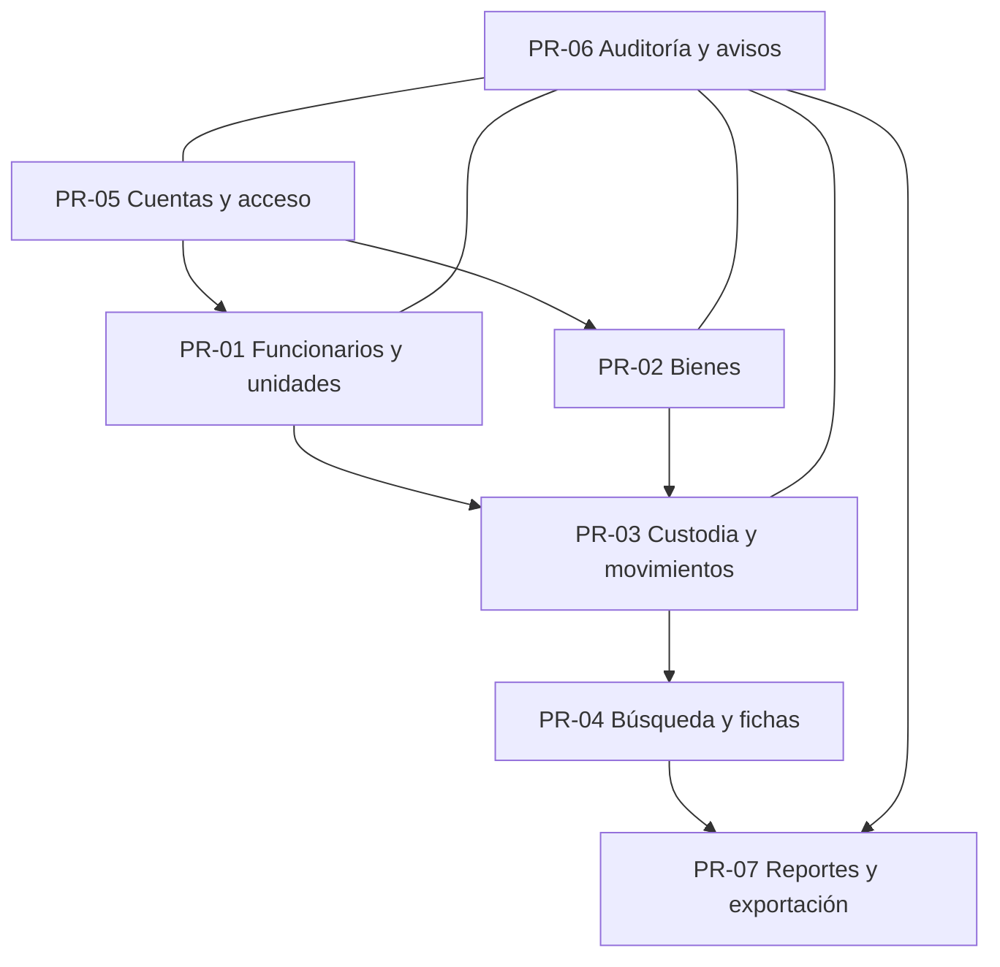

# Análisis empresarial — Fase 1

**Proyecto:** inventarioTI2 · **Fecha:** 2026-10-31 · **Estado:** COMPLETADA.

Análisis documental del MVP aceptado en Fase 0. Fuente: [visión](VISION.md), [requisitos](REQUISITOS.md), [decisiones](DECISIONES.md) y autorización de [Fase 1](../FASES.md). Los procesos describen comportamiento esperado, no una operación ya observada en la organización ni funcionalidades implementadas. No se realizaron entrevistas ni se incorporaron datos reales.

## Plan ejecutado y límites

1. Recuperar la documentación vigente y preservar sus identificadores y decisiones.
2. Describir actores, responsabilidades, procesos, casos de uso, reglas y excepciones de los siete módulos.
3. Desarrollar historias y criterios verificables, con trazabilidad completa y dependencias abiertas.
4. Revisar coherencia, enlaces, cobertura y límites; actualizar continuidad y sincronizar GitHub.

Dependencias: Fase 0 aceptada; RF-01 a RF-16 y RNF-01 a RNF-07 disponibles. Codex prepara y verifica documentos; el usuario valida reglas de negocio y cierre. Riesgo principal: convertir interpretaciones en reglas; se controla distinguiendo confirmaciones de condiciones pendientes. Resultados de negocio ratificados en D-14 y CIERRE_FASE1; cualquier cambio posterior requiere decisión registrada. Sin código, prototipo, arquitectura, tablas, políticas, instalación de herramientas, correo real ni despliegue.

## Áreas y catálogo de actores

Las áreas son agrupaciones funcionales propuestas; no se presume un organigrama ni personas asignadas.

| ID | Actor / área funcional | Objetivo y responsabilidad | Acceso y límites |
|---|---|---|---|
| ACT-01 | Administrador / gestión de inventario y acceso | Mantener funcionarios, bienes, custodia, cuentas y configuración; examinar cambios | Único rol con escritura; no cambia su propio rol ni elimina historia; auditoría administrativa según P-01 ratificada |
| ACT-02 | Usuario de lectura / consulta y control | Localizar bienes y responsables; consultar historia y exportar información autorizada | Consulta todo el inventario e historial; ninguna escritura; sin acceso a auditoría por P-01 ratificada |
| ACT-03 | Funcionario / unidad organizativa | Persona a quien se asignan bienes, con cargo y pertenencia | Entidad de negocio, sin acceso implícito; puede tener varios bienes; identidad RUT/ID según A-01 aprobada |
| ACT-04 | Encargado de bienes / seguimiento | Recibir avisos de cambios en la dirección configurada | Destinatario, no tercer rol ni cuenta obligatoria; eventos y minimización aprobados en A-07/A-10 |
| ACT-05 | Usuario aprobador / gobierno del proyecto | Ratificar requisitos, pendientes y aceptación de fases | Responsabilidad del proyecto, no permiso de aplicación; no se presume que sea administrador |

Una persona puede desempeñar varias responsabilidades; no se crean roles adicionales. La unidad es referencia organizativa, no un actor con credenciales. El servicio de correo es una dependencia externa por definir, sin proveedor elegido.

## Glosario y distinciones

- **Bien:** equipo inventariable identificado por serie/código según RF-02; reglas de obligatoriedad y normalización abiertas.
- **Funcionario:** persona responsable de bienes; distinto de la cuenta que registra acciones.
- **Asignación vigente:** relación actual de custodia de un bien con un funcionario; máximo una por bien. Intervalos inicio incluido/fin excluido según A-04/A-06, en UTC.
- **Movimiento:** hecho empresarial fechado (asignación, devolución, traslado, condición o baja), con motivo y administrador responsable.
- **Auditoría:** evidencia de quién cambió qué y cuándo, incluyendo valores anteriores/nuevos pertinentes; no reemplaza la historia empresarial.
- **Baja lógica:** conserva registro y referencias; baja bloqueada con custodia y reactivación sin restaurar asignaciones (A-03).
- **Condición física:** bueno, regular o malo. P-02 ratificada: separada de custodia y baja.
- **Fecha efectiva / fecha de registro:** momento del hecho frente al momento de registrarlo. UTC por decisión expresa del usuario; movimientos al confirmar sin retroactividad y cortes de días UTC según A-04/A-06.

## Mapa de procesos

Las flechas expresan dependencias de negocio, sin prescribir pantallas ni orden de implementación. Acceso y auditoría son transversales.

## Procesos y casos de uso

En operaciones de escritura se exige administrador autorizado y se conserva actor/fecha. Un rechazo por permisos, integridad o conflicto no debe producir cambios de negocio parciales; el tratamiento específico del fallo de correo sigue P-04/A-07. Las confirmaciones críticas y motivos están definidos en A-03/A-08; interfaz pendiente de su fase.

| ID / módulo | Disparador, actores y precondiciones | Flujo normal y resultado esperado | Alternativas, excepciones y decisiones |
|---|---|---|---|
| PR-01 / M01 | Alta, edición, cambio de unidad o baja; ACT-01 sobre ACT-03; cuenta habilitada | Capturar datos RF-01, validar identidad acordada, registrar cambio y auditoría; conservar pertenencia y referencias consultables | Identidad inválida/duplicada según A-01; baja con bienes, reactivación e historia de unidades según A-03/A-05; lectura denegada para escritura |
| PR-02 / M02 | Incorporación o actualización de equipo; ACT-01 | Registrar características RF-02; comprobar identidad; guardar bien y evidencia de cambio; permitir consulta | Serie/código duplicados rechazados incluso concurrentemente; falta de serie, normalización y heredados según A-02; condición no decide custodia automáticamente; baja por PR-03 |
| PR-03 / M03 | Registrar asignación, devolución, traslado, condición o baja; ACT-01; bien y funcionarios referenciados | Identificar bien y tipo; recoger fecha efectiva, motivo y origen/destino aplicables; validar custodia; registrar movimiento, situación resultante y auditoría de manera coherente | Doble asignación rechazada; fecha solapada/retroactiva según A-04; baja/inactividad según A-03; cambio de unidad según A-05; corrección por anotación vinculada y compensaciones, sin editar historia |
| PR-04 / M04 | Consulta de ACT-01/ACT-02 con sesión autorizada | Buscar bienes/funcionarios en barra única, combinar filtros, abrir ficha y consultar custodia actual e historia; exportar resultados por PR-07 | Sin coincidencias: resultado vacío identificable; acceso no autorizado rechazado; campos de búsqueda cubiertos en HU-06; fechas UTC y unidad actual/histórica según A-05/A-06 aprobadas |
| PR-05 / M05 | Gestión de cuenta por ACT-01 o recuperación por titular de cuenta | Administrar nombre/correo/rol/activación y cambio obligatorio de contraseña; recuperar acceso por correo temporal; preservar identidad en historia | Sin autorregistro; cambio de propio rol y pérdida del último administrador rechazados incluso concurrentemente; primer administrador, invitación, expiración, MFA y revocación según A-08 |
| PR-06 / M06 | Cambio previsto en RF-12, consulta de auditoría o cambio de destinatario; ACT-01; ACT-04 recibe avisos | Registrar actor, fecha, entidad, acción, anterior/nuevo sin secretos; filtrar evidencia; auditar configuración; avisar de eventos acordados y registrar resultado | Historia/auditoría no se editan ni borran por cuentas de aplicación; lectura sin auditoría por P-01; eventos, destinatario fijado, fallo no revierte negocio y reintentos definidos en A-07/P-04 |
| PR-07 / M07 | Solicitud de reporte o exportación por ACT-01/ACT-02 según permiso | Elegir uno de cinco reportes o resultados del buscador; aplicar filtros y columnas acordadas; producir Excel/PDF coherente con datos consultados | Sin datos: salida identificable; exceso de volumen/comportamiento de error según A-09/A-11; auditoría depende P-01; corte temporal y columnas según A-06/A-11 aprobadas |

### Desglose de PR-03: casos de uso críticos

| ID | Caso y recorrido | Postcondición verificable | Excepciones por cubrir |
|---|---|---|---|
| CU-01 | Asignar bien sin asignación vigente a funcionario; registrar inicio, motivo y responsable | Bien con una asignación vigente; funcionario puede acumular otros bienes; historia correlacionada | Dos peticiones sobre mismo bien: una sola custodia; rechazar inactivos y bienes en baja/malo según A-03 |
| CU-02 | Devolver bien asignado; registrar fin, fecha, motivo y responsable | Custodia finalizada y referencias históricas conservadas | Devolución de no asignado y repetición de solicitud: rechazar sin custodia y devolver resultado original al repetir correlación (A-04); nunca crear historia incoherente |
| CU-03 | Trasladar de funcionario origen a destino; registrar fecha y motivo | Origen deja de ser custodio y destino es custodio vigente; ambas fichas concuerdan sin solapamiento | Origen que ya cambió, destino inactivo o igual al origen: rechazar según A-03/A-04; sin cierre parcial del traslado |
| CU-04 | Registrar cambio de condición con anterior/nueva condición | Movimiento y ficha reflejan condición coherente; no se infiere devolución o baja | Misma condición, fecha retroactiva y necesidad de motivo específico según A-04/P-02 |
| CU-05 | Dar de baja lógicamente un bien con motivo y fecha | Bien y su historia siguen consultables, sin borrado físico | Con custodia vigente, baja bloqueada; reactivar requiere administrador/motivo sin restaurar custodia (A-03) |
| CU-06 | Detectar error en movimiento y solicitar corrección | Movimiento original intacto y anotación inmutable y compensaciones vinculadas | A-04 aprobada: anotación y compensaciones ordinarias; no editar original ni revertir custodias intermedias |

## Catálogo de reglas de negocio

**C:** confirmado por RF/RNF/D; RN-17 a RN-19 ratificadas por D-14. Los detalles se encuentran en CIERRE_FASE1. Las restricciones técnicas aquí citadas son requisitos, sin diseño de solución.

| ID | Regla | Estado / fuente | Desarrollo y seguimiento |
|---|---|---|---|
| RN-01 | Solo administrador modifica; lectura consulta inventario/historial y exporta lo autorizado | C · D-02, RF-08 | Acceso a auditoría en P-01 |
| RN-02 | Funcionario y cuenta de acceso son conceptos distintos | C · RF-01/RF-09, VISION | Identidad de funcionario A-01 |
| RN-03 | Serie y código de inventario son únicos; rechazar duplicados sin cambio parcial | C · D-04, RF-02 | A-02 fija comparación, obligatoriedad y heredados |
| RN-04 | Un bien tiene como máximo una asignación vigente; un funcionario puede tener varias | C · D-04, RF-03 | A-04/A-06 fijan intervalos, no la cardinalidad |
| RN-05 | Movimiento conserva bien, origen/destino aplicables, fecha, motivo y administrador responsable | C · RF-04 | A-03/A-04/A-05 detallan admisibilidad |
| RN-06 | Cuentas de aplicación no editan ni borran movimientos o auditoría | C · D-03, RF-05/RF-12 | Corrección empresarial A-04; retención A-10 |
| RN-07 | Bajas son lógicas y conservan referencias e historia | C · D-03, RF-01/RF-04 | Efectos y reactivación A-03 |
| RN-08 | Cuentas solo por administrador; no hay autorregistro público; conservar identidad histórica al desactivar | C · D-02, RF-09 | Primera cuenta, invitación y revocación A-08 |
| RN-09 | No cambiar propio rol ni desactivar/degradar último administrador activo, también concurrentemente; confirmar acciones críticas | C · D-05, RF-11 | Detalle de confirmaciones A-08 |
| RN-10 | Recuperación por correo con enlace temporal y uso limitado, sin exponer contraseñas | C · RF-10 | Caducidad, invitación y MFA A-08 |
| RN-11 | Auditar cambios de bienes, funcionarios, movimientos, cuentas/roles/activación y configuración; actor, fecha, entidad, acción, anterior/nuevo pertinentes; sin secretos | C · RF-12 | Acceso/retención A-10, P-01 |
| RN-12 | Solo administrador configura destinatario; cambio auditado afecta avisos posteriores | C · RF-14 | Aviso al anterior/nuevo destinatario A-07 |
| RN-13 | Avisos automáticos de cambios con qué/quién/cuándo y resultado de envío registrado | C · RF-15 | Catálogo de eventos, privacidad y fallos A-07/A-10 |
| RN-14 | Cinco reportes y buscador exportan Excel/PDF con filtros y permisos conservados | C · D-06, RF-07/RF-16 | Fechas, columnas y límites A-06/A-11; auditoría P-01 |
| RN-15 | Autorizar fuera de la interfaz; integridad también bajo concurrencia y sin estados parciales | C · RNF-01/RNF-02 | Controles técnicos en fases posteriores |
| RN-16 | Diferenciar fecha efectiva y fecha de registro; UTC elegida expresamente por el usuario | C · RNF-03 | Retroactividad, extremos y cortes A-04/A-06 |
| RN-17 | Auditoría consultable/exportable exclusivamente por administrador | C · P-01/D-14 | Lectura accede a historia empresarial; no a auditoría |
| RN-18 | Separar condición física de asignación y baja administrativa | C · P-02/D-14 | Tres dimensiones y transiciones definidas en A-03 |
| RN-19 | Conservar operación válida ante fallo de correo y permitir reintento controlado | C · P-04/D-14 | A-07 aprobada; sin garantía de entrega exactamente una vez |

## Resoluciones de Fase 1 y seguimiento

[CIERRE_FASE1.md](CIERRE_FASE1.md) consolida las decisiones aceptadas por D-14 y CR-01 a CR-20. P-03 conserva el orden inicial. Ningún módulo se retira del MVP. Las alternativas originales se conservan en el cierre y en Git; ya no son preguntas empresariales sin respuesta.

| ID | Resultado aceptado | Evidencia |
|---|---|---|
| A-01 | RUT/ID canónico, obligatorio y único por tipo; correo opcional válido | D-14; CIERRE_FASE1 |
| A-02 | Código obligatorio; serie opcional con motivo y única si existe; no reutilizar identificadores | D-14; CIERRE_FASE1 |
| A-03 | Bajas bloqueadas con custodia; activos admisibles; reactivar sin restaurar asignaciones | D-14; CIERRE_FASE1 |
| A-04 | Al confirmar, sin retroactividad; anotación/compensaciones vinculadas; no duplicar correlación | D-14; CIERRE_FASE1 |
| A-05 | Unidad del funcionario y de su custodio actual; conservar pertenencias/eventos históricos | D-14; CIERRE_FASE1 |
| A-06 | UTC confirmada; rango de días inclusivos y campos por consulta definidos | D-14; CIERRE_FASE1 |
| A-07 | Catálogo, destinatario, minimización y reintentos aprobados; fallo no revierte negocio | D-14; CIERRE_FASE1 |
| A-08 | Primera cuenta controlada, invitación 24 h, recuperación 30 min, MFA y revocación definidos | D-14; CIERRE_FASE1 |
| A-09 | Referencia 1.200/capacidad 3.000; respaldo semanal, RPO 7 días, RTO 8 h, copias 30 días | D-14; CIERRE_FASE1 |
| A-10 | Minimización y no purga por aplicación; política legal a validar en Fase 6 antes de datos reales | D-14; CIERRE_FASE1 |
| A-11 | Cinco reportes/buscador: columnas, orden, fechas, vacío y límites Excel/PDF aprobados | D-14; CIERRE_FASE1 |
| P-01 | Auditoría solo administrador; historia empresarial también para lectura | D-14; CIERRE_FASE1 |
| P-02 | Condición, custodia y baja independientes | D-14; CIERRE_FASE1 |
| P-04 | Operación válida subsiste al fallar correo | D-14; CIERRE_FASE1 |

F1-SEG-01 conserva validación jurídica/retención antes de datos reales; F1-SEG-02 conserva presupuesto/costos en Fase 3; F1-SEG-03 conserva día/hora UTC, alertas y operación del respaldo en Fases 3/14. Cerrar el análisis no ejecuta esas tareas ni elimina riesgos de implementación.

## Entrega y validación

Historias y criterios: [HISTORIAS_USUARIO.md](HISTORIAS_USUARIO.md). Cobertura RF/RNF, módulos y dependencias: [TRAZABILIDAD.md](TRAZABILIDAD.md). Evidencia de revisión documental y pruebas no ejecutadas: [PRUEBAS.md](PRUEBAS.md).

Los siete módulos conservan razón de negocio y escenarios verificables. Entrega COMPLETADA por aceptación D-14; la ejecución y verificación funcional siguen pendientes de fases futuras. La Fase 2 sigue PENDIENTE / NO OTORGADA; no se ha preparado prototipo ni elegido diseño.
