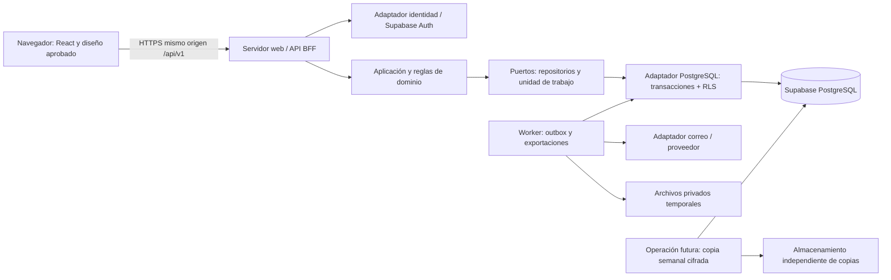

# Arquitectura tecnológica — Fase 3

**Fecha:** 2026-10-31 · **Estado:** COMPLETADA — aceptada por D-17 · **Responsable:** Codex; aceptación: usuario.

Diseño técnico entregado bajo D-15 y la solicitud de esta conversación. No hay aplicación funcional, infraestructura contratada ni controles implantados. Base: [requisitos](REQUISITOS.md), [cierre empresarial D-14](CIERRE_FASE1.md) y [diseño visual aprobado](UX_UI.md). La arquitectura fue aceptada por D-17; Fase 4 autorizada para un nuevo chat, ejecución pendiente.

## Plan, alcance y criterios

Comparar alternativas; seleccionar stack y límites; definir componentes, contratos, integridad, identidad, notificaciones, portabilidad, entornos y costos; revisar cobertura y preservar lo existente; sincronizar GitHub. Insumos aceptados: 250 funcionarios, 900–1.500 bienes estimados (referencia 1.200), capacidad 3.000 bienes/500 funcionarios/25 cuentas/10 usuarios concurrentes/100.000 movimientos y 100.000 auditorías. Nunca equivaler funcionarios a cuentas.

| Criterio | Evidencia / resultado |
|---|---|
| CA3-01 | Alternativas y selección justificadas abajo y en ADR-001/002 |
| CA3-02 | Diagrama, límites de módulos y dependencias definidos |
| CA3-03 | Contratos de consulta/comando/error, transacciones e identidad definidos en CONTRATOS_API |
| CA3-04 | Riesgos, costos, entornos, RLS, SQL Server y F1-SEG-01/02/03 tratados |
| CA3-05 | Revisión documental reproducible y preservación de fases futuras en PRUEBAS y evidencias/fase3 |
| CA3-06 | CUMPLIDO por D-17: usuario acepta la entrega y autoriza Fase 4 en un nuevo chat |

No corresponde a esta fase crear ER, diccionario, SQL, índices, políticas RLS, migraciones, dependencias, backend o configuración de hosting. Los documentos de datos/seguridad/despliegue siguen reservados a sus fases. Spec Kit no está instalado y no se instala.

## Alternativas y selección aceptada

| Alternativa | Ventajas | Costos / límites | Resolución |
|---|---|---|---|
| React + API Node modular + PostgreSQL/Supabase | Un lenguaje, contratos compartibles, transacciones explícitas, RLS y adaptadores sustituibles | Mantener API y proceso de trabajos; integración Auth/DB exige pruebas | Seleccionada, ADR-001/002 |
| Next.js con backend integrado + Supabase | Un servicio web, SSR y convenciones integradas | SSR/SEO aporta poco a un inventario privado; acoplar acciones a framework dificulta aislar adaptadores | Viable; no elegida para este alcance |
| ASP.NET Core + React + SQL Server inicial | Buen encaje empresarial si ya existe equipo/licencias Microsoft | No se ha confirmado equipo ni licencias; no satisface orientación Supabase/RLS inicial sin rediseño | Alternativa futura, no migración decidida |
| Navegador directo a Supabase para todo | Menos servidor propio | Comandos atómicos terminarían repartidos en RPC y políticas; sesiones estrictas, exportaciones y portabilidad más complejas | No elegida |

Monolito modular: React/TypeScript compilado con Vite, API Node.js/TypeScript con Fastify y validación de contratos en servidor; PostgreSQL gestionado por Supabase para persistencia inicial y Supabase Auth como proveedor de identidad. Acceso SQL por adaptador `pg`, sin SQL en componentes. Proceso web y worker son ejecutables del mismo producto/repositorio, no microservicios. No Redis, bus externo, Kubernetes, GraphQL, Realtime ni buscador externo para este volumen sin mediciones que lo justifiquen.

La futura primera implementación debe fijar versiones estables y soportadas, lockfile y compatibilidad Node/React/Vite/Fastify/pg/Supabase SDK, revisar avisos y ejecutar build/pruebas. No se afirma compatibilidad binaria verificada ni se inventa un lockfile en esta entrega documental. Excel/PDF: bibliotecas servidor tras revisar mantenimiento/licencia en Fase 11; PDF tabular sin cargar páginas o URLs arbitrarias. Correo: adaptador SMTP/API transaccional; proveedor definitivo condicionado a dominio, presupuesto y requisitos de privacidad. No es necesario seleccionar una marca de correo ahora.

## Componentes y fronteras de confianza

El BFF sirve archivos de la UI compilada y la API bajo un mismo origen; no introducir CORS abierto. Solo servidor comunica con Auth y base de datos. Navegador lleva cookie opaca HttpOnly/Secure/SameSite y protección CSRF/Origin en mutaciones; tokens del proveedor permanecen en servidor cifrados. No guardar credenciales en localStorage. Autenticación/recuperación son las excepciones públicas, con limitación de tasa y respuestas genéricas. Las claves administrativas del proveedor solo existen en el adaptador de gestión de identidad. No usarlas para consultas empresariales.

## Módulos y dirección de dependencias

| Módulo | Responsabilidad / puerto | Cobertura |
|---|---|---|
| Personas y unidades | Identidad RUT/ID, pertenencias, activos; consulta de disponibilidad | RF-01; HU-01 |
| Inventario | Bien, identificadores canónicos, condición y situación separadas | RF-02; HU-02 |
| Custodia | Asignación/devolución/traslado/condición/baja, corrección por anotación | RF-03, RF-04, RF-05; HU-03/04/05 |
| Consultas | Fichas, búsqueda global, filtros y proyecciones autorizadas | RF-06, RF-07; HU-06/07 |
| Acceso y cuentas | Sesiones de aplicación, rol/estado vigente, MFA, invitación/recuperación, último administrador | RF-08, RF-09, RF-10, RF-11; HU-08/09/10/11 |
| Evidencia y avisos | Auditoría append-only, configuración, outbox y seguimiento de entrega | RF-12, RF-13, RF-14, RF-15; HU-12/13/14/15 |
| Reportes | Selección autorizada común, exportación XLSX/PDF y temporales privados | RF-16; HU-16 |

Reglas de dominio no importan React, SDK Supabase, Fastify ni SQL. Aplicación coordina puertos; adaptadores implementan puertos y se conectan en la composición del servidor. Ningún módulo modifica datos de otro fuera de un caso de uso coordinador y una unidad de trabajo. Consultas pueden leer proyecciones cruzadas bajo autorización. Una transacción local agrupa cambios empresariales, historia, auditoría, resultado idempotente y aviso lógico.

Estructura futura orientativa (no creada): `apps/web`, `apps/server`, `apps/worker`, `packages/domain`, `packages/application`, `packages/contracts`, `packages/adapters`. No es necesario publicar paquetes npm ni multiplicar repositorios. `prototipo/` permanece como referencia visual aceptada, con sus pruebas y muestra efímera; no convertir su selector de rol o arrays en implementación de seguridad/persistencia.

## Integridad, concurrencia y tiempo

UTC explícito en servidor, fichas, filtros y exportaciones; instantes ISO 8601 con `Z`, días civiles UTC y extremos `[desde, día posterior a hasta)`. La fecha efectiva de movimiento la asigna el servidor al confirmar; el cliente no puede retrotraerla ni anticiparla. Distinguir fecha efectiva y registro, además de orden estable para empates. El contrato de cada consulta identifica adquisición/alta/inicio de custodia/efectiva/registro según A-06.

La unidad de trabajo debe bloquear/revalidar el estado del bien y custodios afectados; el mismo cambio incluye custodia, historia inmutable, auditoría y outbox o se revierte completo. Restricciones de unicidad y asignación vigente se definirán en Fase 4. Cambio de unidad conserva custodia y pertenencia histórica; una baja no borra. Último administrador: serializar cambios del conjunto administrativo, releer y comprobar que queda uno activo antes de confirmar, sin confiar en dos conteos aislados. Versión esperada e idempotencia cubren conflictos y pérdida de respuesta; no reemplazan restricciones de base de datos. Detalle en [contratos](CONTRATOS_API.md).

## Identidad y autorización con RLS

Diseño ADR-003: Supabase verifica identidad y segundo factor, mientras la aplicación conserva estado/rol vigente y revocación de sesiones. Cada petición protegida comprueba sesión de aplicación, estado actual, versión de autorización y MFA administrativo; no usa `user_metadata` ni un rol antiguo en JWT. Inactividad 30 min y duración absoluta 8 h se aplican en la sesión del servidor; no dependen de las comprobaciones de refresh del proveedor. Lecturas en background no renuevan actividad de usuario; la futura política de actividad se probará con reloj controlado. Tras revocación, la siguiente petición protegida falla aunque conserve JWT válido.

API SQL con credencial dedicada sin BYPASSRLS, sin propiedad de tablas ni permisos DDL. Contexto de actor/sesión verificado se fija localmente dentro de cada transacción; nunca desde campos de petición ni con estado persistente en conexiones del pool. RLS vuelve a comprobar cuenta/sesión y capacidades actuales. Para lecturas de historial/inventario ambos roles tienen acceso al ámbito aprobado; auditoría/cuentas/configuración solo administrador. No aplicar propiedad `user_id` a inventario compartido por copiar una plantilla. La política técnica y cualquier función auxiliar privada requieren revisión de privilegios y pruebas negativas en Fase 6.

No exponer tablas de negocio por Data API al navegador; revocar accesos innecesarios de anon/authenticated y verificar esquemas expuestos. RLS también en esquemas privados como defensa adicional. Vista futura que pueda exponerse debe respetar contexto invocador; no introducir SECURITY DEFINER para arreglar un permiso. Inmutabilidad de historia/auditoría también por privilegios; el permiso de anexar evidencia corresponde al caso de uso, no permite UPDATE/DELETE. Operador de base de datos sigue siendo una frontera privilegiada: no prometer protección contra el dueño del motor.

Invitación 24 h y recuperación 30 min, un uso e invalidación de enlaces anteriores: no se supone que un ajuste global del proveedor cumpla ambos. Adaptador incorpora intención versionada de un uso en servidor, evita reenvío automático por escáner de enlaces y prueba expiración/reenvío/activación; los enlaces no contienen secretos en logs. Cuentas pendientes no operan. Si las capacidades del proveedor no permiten el contrato exacto, se bloquea la aceptación de Fase 5 y se revisa el adaptador, sin rebajar D-14. MFA administrativo antes de operar; recuperación del factor exige procedimiento verificado de identidad, revocación y auditoría, nunca un bypass autoservicio. Primer administrador solo mediante puesta en marcha explícitamente autorizada.

Cambios de cuenta cruzan Auth y PostgreSQL y no forman una transacción distribuida. Diseñar operación persistente con estados pendiente/completada/fallida, correlación y conciliación: desactivación o cambio de rol/revocación local se confirman atómicamente primero y bloquean acceso desde ese momento; la llamada externa se reintenta de forma controlada. Invitación crea pendiente sin acceso y se activa solo tras verificar identidad/estado/MFA. Forzar contraseña bloquea sesiones antes de pedir acción externa. Cancelar en UI antes de confirmar no crea operación. No afirmar atomicidad entre proveedores.

## Notificaciones, trabajos y reportes

Outbox transaccional fija destinatario, propósito, actor y evento al confirmar; configuración nueva no redirige pendientes. Worker adquiere trabajo con exclusión/arrendamiento y correlación estable; no enviar dentro de la transacción empresarial. Intento inicial ≤ 1 min como objetivo; tres reintentos transitorios a 1/5/15 min desde fallo anterior. Fallo permanente detiene; timeout tras enviar pasa a incierto. Conciliar por ID de proveedor/webhook autenticado o revisión administrativa con motivo; no reenviar a ciegas. Aceptación por proveedor no prueba entrega ni lectura. Cancelación de pendiente y reintento manual conservan evidencia. No prometer exactamente una vez. Avisos sin RUT/correo personal/texto libre; invitación/recuperación solo al titular. Worker usa permisos limitados a trabajos y sus proyecciones necesarias; no cuenta de aplicación administrativa general.

Reportes comparten selección y autorización con consultas: cinco salidas y dos conjuntos de búsqueda conforme A-11. XLSX hasta 10.000 filas, PDF hasta 2.000: contar sobre la misma instantánea de lectura que genera archivo y rechazar exceso sin truncar. Generar en worker para aislar memoria/tiempo de la API; objetivo extremo a extremo ≤ 60 s por verificar. Descargar solo con sesión actual y permiso vigente, vincular trabajo al solicitante y volver a validar rol, especialmente auditoría. Temporales privados con caducidad técnica propuesta de 1 h, sin URLs públicas permanentes ni copias en logs; no es plazo de conservación empresarial. Escapar fórmulas en XLSX, texto en PDF y no permitir columnas arbitrarias. No usar el estado «actual» como corte histórico reconstruido.

## Entornos, hosting y costos — F1-SEG-02

Selección de referencia para dimensionar: Render, servicio Node persistente para web/API y worker, Supabase gestionado para DB/Auth, almacenamiento privado independiente para copias y adaptador de correo transaccional. Región cercana entre API/DB/worker se confirmará por disponibilidad y tratamiento de datos; no atribuir residencia en Chile por país del usuario. Hosting sustituible mediante proceso Node y configuración externa. No se crea cuenta, servicio, dominio, secreto ni suscripción.

| Entorno futuro | Aislamiento y uso | Costo / condición |
|---|---|---|
| Local | Servicios y credenciales de prueba, datos sintéticos, correo capturado; builds y tests | Sin costo de proveedor asumido; recursos del equipo |
| Pruebas/staging | Proyecto DB/Auth separado, dominio/cookies/claves separados, sin datos productivos | Free solo para prueba temporal; referencia persistente pagada añade al menos 42 USD/mes (10 DB + 25 web + 7 worker), sujeto a plan/límites |
| Producción | DB/Auth independiente, web y worker persistentes, secretos por servicio, observabilidad y copias externas | Solo tras presupuesto, privacidad y autorización de operación |

Estimación orientativa USD/mes, precios públicos consultados el 2026-10-31, sin impuestos/IVA, cambio a CLP ni excedentes:

| Partida de referencia | Importe / fundamento |
|---|---|
| Supabase Pro, un proyecto Micro incluido mediante crédito de cómputo | Desde 25 USD/mes; no confundir 7 días de backup incluido con conservación 30 días |
| Render web/API 1 CPU / 2 GB | 25 USD/mes; tamaño candidato, no benchmark |
| Render worker 0,5 CPU / 512 MB | 7 USD/mes; subir si exportaciones lo requieren |
| Copias externas, correo, monitoreo y dominio prorrateado | Reserva de planificación 10–30 USD/mes; proveedores/cuotas no cotizados |
| Total escenario productivo base | 67–87 USD/mes: 25 + 25 + 7 + (10–30) |
| Base más staging persistente de referencia | 109–129 USD/mes: base + 42; almacenamiento y tráfico extra no incluidos |

No incluye desarrollo, soporte humano, recuperación ante incidentes, MFA de pago por canal, planes de workspace/equipo, alta disponibilidad ni SLA contratado. Free no se considera garantía para 99,5 %. Proyección debe recalcularse con mediciones y cotización real antes de contratar. **F1-SEG-02 permanece abierto:** presupuesto máximo, moneda de aprobación y autorización de gasto no informados. La arquitectura documental es revisable sin esos datos; la compra queda bloqueada. No pedir ni asumir gasto para terminar esta fase.

## Continuidad operativa propuesta — F1-SEG-03

Requisitos intactos: una copia semanal, nunca más de 7 días entre copias exitosas, RPO ≤ 168 h, RTO ≤ 8 h y conservación 30 días; restauración antes de producción y trimestral. Propuesta revisable: domingo 02:00 UTC, copia lógica consistente cifrada fuera del proyecto/proveedor primario, con manifiesto de versión, integridad y resultado. Aclarar cobertura de datos, usuarios/identidad, configuración de Auth, esquemas/roles y referencias a secretos gestionados fuera de Git; no basta volcar tablas públicas. No se pretende restaurar tokens/sesiones activas: revocarlas en recuperación y reautenticar.

Copias gestionadas diarias de Supabase Pro son complementarias y conservan 7 días según documentación consultada; no cumplen solas los 30 días ni independencia ante pérdida del proyecto. La copia lógica externa y el ensayo de restauración deberán demostrar cobertura real de Auth/permisos, exportación y compatibilidad de versión. Sin adjuntos en alcance MVP; si se añaden archivos, incorporar objetos y sus metadatos al plan. No afirmar restauración completa por tener pg_dump.

Monitorear edad de última copia buena; prealerta a 6 días y alarma al fallar o acercarse a 168 h; reintento inmediato controlado y escalamiento humano. Una programación exacta cada 7 días no deja margen para un fallo: ajustar próxima ejecución al éxito previo y adelantarla si hace falta; si se supera 168 h registrar incumplimiento, no reiniciar la métrica ocultándolo. Ventana, operador/guardia, ubicación, cifrado/custodia de claves, costo y canal de alarma deben aprobarse en Fase 14. Objetivos de disponibilidad 99,5 %, consulta p95 ≤ 2 s y escritura p95 ≤ 3 s requieren ensayos; no son garantías de estos tamaños.

Logs estructurados con correlación, duración, código y operación; excluir documentos, tokens, contraseñas y payloads personales. Métricas: errores/latencia, cola/avisos inciertos, exportaciones, edad de copia y restauración. Auditoría empresarial separada de logs técnicos; su política legal continúa en F1-SEG-01. No se configuran pipelines ni despliegues automáticos; un futuro CI de prueba no debe desplegar por push sin autorización específica.

## Portabilidad a SQL Server

Puertos de repositorio/unidad de trabajo/identidad/correo/archivo aíslan dependencias. Contratos HTTP, reglas, UTC y pruebas de aceptación se conservan; SQL, RLS, bloqueos, índices, tipos, funciones, paginación y herramientas de respaldo se reimplementan en un adaptador SQL Server. Supabase Auth no migra con la base empresarial: decidir conservarlo o migrar identidades con procedimiento propio, sin prometer portabilidad de contraseñas/MFA/sesiones. Outbox y auditoría mantienen semántica, no sintaxis. Los mismos escenarios CR-01 a CR-20 son el contrato del nuevo adaptador; ensayar conteos, historia, unicidad y permisos antes de cualquier cambio. No ORM universal ni doble escritura preventiva. D-07 es objetivo de adaptación futura, no compatibilidad implementada.

## Riesgos, pendientes y fases responsables

| Riesgo / seguimiento | Respuesta y puerta de verificación |
|---|---|
| R-01/R-02: historia y concurrencia | Unidad de trabajo, restricciones y bloqueos; Fases 4/7/9/10, conflictos paralelos con datos sintéticos |
| R-03: bypass de BFF/RLS o JWT antiguo | Credenciales mínimas, contexto local y cuenta vigente; pruebas directas de API/DB y pool en Fases 5/6/7 |
| R-04: dependencia de motor e identidad | Adaptadores y pruebas semánticas; nueva migración requiere proyecto/autorización propios |
| R-05: duplicados/fallo de correo | Outbox/conciliación y recuperación de worker; Fase 12 |
| F1-SEG-01: retención legal sin informar | Organización/privacidad en Fase 6, antes de datos reales; no afirmar cumplimiento ni plazo indefinido |
| F1-SEG-02: presupuesto no informado | Estimación anterior, confirmar tope/proveedores antes de gasto; no se considera resuelto |
| F1-SEG-03: operación no configurada | Diseño anterior; operador, ubicación, horario y restauración real en Fase 14 |
| Integración Auth/sesión/enlaces estrictos | Prueba de concepto autorizada en Fase 5; bloqueo si no cumple D-14 |
| Exportación y hardware móvil | Medir memoria/tiempo Fase 11/13; conservar diseño, probar Safari/hardware sin inferirlo de emulación |

## Fuentes técnicas y límites de verificación

Leídas el 2026-10-31 por HTTPS (HTTP 200): [changelog](https://supabase.com/changelog.md), [cambio PostgreSQL de seguridad](https://supabase.com/changelog/postgres-15-19-17-11-breaking-changes), [RLS](https://supabase.com/docs/guides/database/postgres/row-level-security.md), [sesiones](https://supabase.com/docs/guides/auth/sessions.md), [backups](https://supabase.com/docs/guides/platform/backups.md), [precios Supabase](https://supabase.com/pricing), [precios Render](https://render.com/pricing). El aviso de actualización PostgreSQL/índices/cifrados debe revisarse al fijar motor; no hay base existente que actualizar en esta fase. Revalidar versiones, planes y precios antes de implementar/contratar. La documentación del proveedor no verifica una instalación real del proyecto.

Entregables relacionados: [ADR](adr/FASE3.md), [contratos](CONTRATOS_API.md), [evidencia](PRUEBAS.md). Verificación documental no acredita seguridad, rendimiento, compatibilidad de librerías ni recuperación reales. CA3-06 cumplido por D-17. Siguiente acción: iniciar Fase 4 en un nuevo chat con autorización ya otorgada.

## Aceptación posterior — D-17

2026-10-31: «Apruebo y inicia fase 4 en un chat nuevo». Arquitectura, contratos y ADR aceptados como diseño; Fase 3 COMPLETADA. Las referencias a propuestas describen alternativas y detalles operativos sujetos a sus puertas: presupuesto no aprobado, horario/operador/ubicación no configurados y F1-SEG-01/02/03 abiertos. No se implementa ni contrata por esta aprobación. Fase 4 autorizada para un nuevo chat; fases 5–15 y despliegues sin autorización.

## Concreción de ADR-005 — Fase 11

Reportes/exportación implementados en [REPORTES](REPORTES.md): consulta/proyección positiva compartida, instantánea consistente persistida, cola privada por proceso con claim SQL/arrendamiento recuperable, render en hilo, archivos privados en PostgreSQL y descarga por BFF autenticado con permiso vigente. No se requiere servicio externo ni almacenamiento público. XLSX write-excel-file 4.1.1 y PDFKit 0.20.2, versiones/lockfile/licencias revisados; límites técnicos y de filas explícitos. Recuperación tras reinicio depende de consulta/replay del solicitante; no cron ni procesamiento de avisos. Rendimiento/infraestructura objetivo siguen sin acreditarse.

## Incremento implementado de Fase 12 — D-34

Se materializa el consumidor de outbox de ADR-004 como ejecutable independiente del mismo producto (`apps/server/notifications/main.ts`), sin activación desde web. Puerto MailPort y adaptador Resend preparado, reclamación/arrendamiento/token, estados/intentos/reintentos y seguimiento administrativo. No cambia la transacción empresarial ni mezcla identidad/exportaciones. Diseño técnico, límites de idempotencia, conciliación manual con evidencia y permisos en [NOTIFICACIONES](NOTIFICACIONES.md). Sin proveedor/dominio/costo/operación gestionados ni despliegue acreditados.
