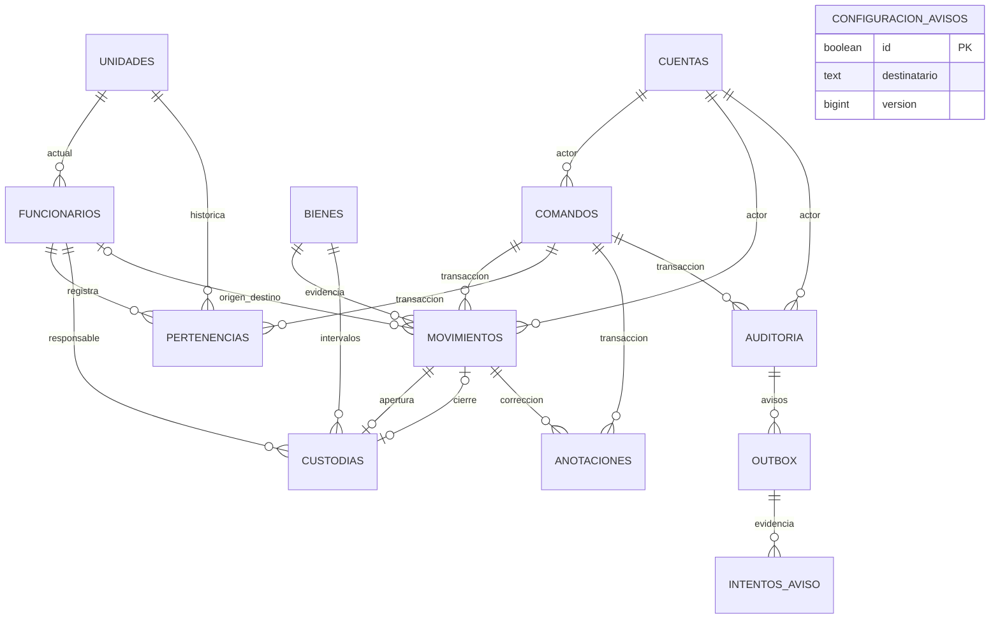

# Modelo y persistencia — Fase 4

**Fecha:** 2026-10-31 · **Estado:** COMPLETADA y aceptada por D-19. Implementación local con datos sintéticos; cierre aprobado el 2026-10-31. Insumos: D-14, D-17, [arquitectura](ARQUITECTURA.md), [contratos](CONTRATOS_API.md) y [cierre empresarial](CIERRE_FASE1.md). Fase 5 autorizada para un nuevo chat, ejecución pendiente; sin despliegue.

## Plan y alcance ejecutado

Modelar entidades y cardinalidades, crear diccionario y esquema PostgreSQL, verificar restricciones/índices, migración limpia/repetible, concurrencia y restauración aisladas; documentar límites y sincronizar GitHub. Responsable de desarrollo/verificación: Codex; revisión/cierre: usuario. Solo datos sintéticos. No se configura un proyecto remoto, Auth, sesiones, permisos funcionales, API, worker ni respaldo operativo.

## Modelo conceptual y lógico

Funcionario representa una persona responsable; cuenta representa un actor de aplicación y no necesita pertenecer a un funcionario. Bien conserva identidad durante toda su vida. Custodia relaciona un bien con un funcionario mediante intervalos semiabiertos `[inicio, fin)`; fin nulo significa vigente. Un funcionario puede custodiar muchos bienes; un bien admite como máximo una custodia vigente y no admite intervalos solapados. No hay ubicación del bien independiente de la unidad actual del custodio.

Unidades, funcionarios y bienes están normalizados; condición, situación administrativa y custodia son dimensiones separadas. El tipo de bien es texto identificable, sin agregar un módulo de catálogo no acordado. Los dominios pequeños se restringen con CHECK para no introducir enums PostgreSQL innecesarios. UUID para referencias opacas; bigint identity para secuencia estable de evidencia. No usar el documento como PK ni ruta. Las FK no eliminan referencias en cascada.



Desnormalizaciones deliberadas: nombres de unidad en movimientos/pertenencias para preservar denominaciones históricas; unidad actual en funcionario para consulta; intervalo de custodia como proyección de aperturas/cierres del libro de movimientos; huella/resultado idempotente para recuperar un commit; destinatario en outbox para fijarlo al confirmar. La proyección de custodia admite únicamente un cierre, sin cambiar bien/funcionario/apertura/inicio y sin reapertura ni borrado. El cierre no modifica el movimiento original. El servicio futuro coordinará proyecciones y evidencia; no existe reconstrucción agregada de inventario a una fecha pasada.

El [diccionario](DICCIONARIO_DATOS.md) enumera todas las columnas; el SQL versionado es la definición física exacta. No se añaden tablas de contraseñas, sesiones, enlaces de recuperación, exportaciones o conciliación Auth anticipando sus fases. Cuenta es solo referencia persistente de actor/rol/estado para el modelo, sin acceso efectivo.

## Integridad física y concurrencia

- Normalización RUT: sin puntos, espacios ni guion, DV mayúscula y módulo 11; ID alternativo: trim exterior y mayúsculas, conserva interior. Unique tipo/documento canónico incluye inactivos.
- Código obligatorio y serie opcional: comparación mayúscula/trim exterior, preservando interiores. Índices únicos sin filtro de baja; serie nula exige motivo. No compartir «SIN SERIE» como sustituto.
- Unidades inactivas rechazan nuevas pertenencias actuales. Baja de funcionario o bien se rechaza con custodia. Cambiar condición a malo conserva al custodio; nueva asignación exige bien activo bueno/regular y funcionario activo.
- Índice único parcial por bien con `fin_en is null`; verificación de solapamiento bajo bloqueo `FOR UPDATE` del bien y del funcionario. Apertura/cierre referencian movimientos del mismo bien, tipo/destino/origen compatibles, y toman su fecha efectiva. Solo un intervalo puede usar cada apertura/cierre.
- Maestros incrementan versión al actualizar; la comprobación de versión esperada/If-Match corresponde al adaptador futuro. No se implementa autorización por cuenta/rol en los triggers.
- Movimientos, pertenencias, anotaciones, auditoría, comandos confirmados e intentos rechazan UPDATE/DELETE/TRUNCATE. Maestros exigen baja lógica. Triggers invocadores, sin SECURITY DEFINER; el propietario/DBA sigue siendo privilegiado.
- Instantes `timestamptz`, fechas de adquisición `date`, UTC explícito en pruebas/consultas. Fecha efectiva/registro se asigna en base de datos después de bloquear el recurso, ignorando retroactividad enviada. Traslado cierra/abre usando el mismo movimiento e instante; secuencia resuelve empates.
- Unidad/nombre históricos se obtienen de la base al insertar movimiento. Cambiar pertenencia o renombrar unidad no reescribe los eventos anteriores. La pertenencia histórica se anexa con actor, motivo y comando.
- Orden de bloqueo del futuro adaptador: bien, funcionarios ordenados por UUID, unidades. Prebloquear todos los recursos implicados antes de cambios de varios bienes. Los deadlocks o fallos de serialización requieren rollback/reintento controlado de la transacción, sin repetir efectos externos.

Cada FK tiene un índice con su primera columna a la izquierda. Índices adicionales: adquisición/id; condición/situación/id; movimientos por bien/fecha/id y unidades históricas; auditoría por registro/id y entidad/ref; pendientes outbox por siguiente intento/id. La muestra pequeña verifica ejecución de consultas, no justifica índices por un benchmark. No se añaden trigramas, particiones ni extensiones.

## Atomicidad, idempotencia y trabajos

La unidad de trabajo de Fases 7/10 deberá confirmar maestro/custodia + movimiento + auditoría + comando + outbox juntos, en una conexión. Se prueba commit/rollback SQL conjunto, no un endpoint inexistente. Las FK y unicidad no exigen por sí solas que cada cambio de maestro cree evidencia: esa coordinación y los permisos de escritura limitados siguen pendientes; solo el dueño de migraciones puede escribir ahora. No exponer este esquema como aplicación terminada.

`comandos` guarda actor/operación/recurso/clave UUID, SHA-256 de payload canónico y resultado JSON. La unicidad arbitra duplicados; un servicio futuro autoriza primero, compara huella y devuelve el resultado antes de validar la versión antigua. No hay replay HTTP implementado ni TTL de purga arbitrario.

`outbox` referencia auditoría, destinatario y propósito únicos; esos campos son inmutables. No copia RUT, observaciones ni motivos en su payload; el worker futuro debe construir una plantilla mínima con referencias. Pendiente/procesando/aceptado/entregado/fallido/incierto/cancelado son estados persistibles, con próximo intento/arrendamiento/correlación externa. Intentos son append-only. No hay envío ni máquina de transiciones implementada; tiempos 1/5/15 min, cancelación, conciliación y adquisición exclusiva corresponden a Fase 12. No se afirma entrega exactamente una vez.

## Migración y reproducción segura

[20261031053433_modelo_inicial.sql](../supabase/migrations/20261031053433_modelo_inicial.sql) fue creada con `npx --yes supabase@2.122.0 migration new modelo_inicial`, tras consultar `--version` y ayuda. Es aditiva y transaccional; no contiene DROP ni purgas. No modificarla después de aplicarla en un entorno compartido: crear otra migración con la CLI y revisar su delta. Spec Kit no está instalado ni se instala.

[Suite reproducible](../tests/datos/verificar.py):

```sh
docker pull postgres:17@sha256:31ba9c94a03ada9988f2bb493a22a75eef3a185884533e5cdbcd498ea835b08f
python3 tests/datos/verificar.py
```

Requiere Docker y Python 3; no dependencias Python/npm de aplicación. PostgreSQL 17.11 fijado por digest. La suite crea un contenedor único sin red ni puertos, aplica migración bajo transacción, registra nombre/SHA-256 en `migraciones.versiones` y verifica la segunda aplicación sin duplicarla; carga [seed sintético](../db/seed_prueba.sql), ejecuta pruebas y restaura en otra base vacía del mismo contenedor. Al terminar elimina exclusivamente el contenedor y sus volúmenes de prueba. La autenticación trust solo existe dentro de ese contenedor sin red; nunca es configuración productiva. No acepta DSN remota ni ejecuta reset sobre una base existente.

Las [consultas de referencia](../db/consultas.sql) prueban inventario/unidad actual, adquisición y movimientos por días UTC, y selección exclusiva de trabajo con SKIP LOCKED. Un rango invertido debe rechazarse en servidor futuro; no hay API de filtros implementada.

Se verificó `pg_dump -Fc`/`pg_restore --exit-on-error` de esta muestra, comparando todas las filas, secuencia de movimientos y rechazo de modificación de evidencia restaurada. Es restauración lógica de esquema sintético local: no incluye Supabase Auth, secretos, configuración de proyecto, roles productivos ni objetos externos. `--no-owner --no-acl` restaura con propietario de prueba: NO acredita recuperación de permisos productivos. El historial de migraciones de la suite no es el historial remoto Supabase. No se inició la pila Supabase, no se ejecutaron advisors remotos ni `migration list --local` sobre un proyecto inexistente. Revisión local de RLS, funciones invocadoras, privilegios e índices ejecutada; integración Supabase queda para sus fases.

## Privacidad, retención y portabilidad

Esquema `inventario` privado, sin grants PUBLIC, todas las tablas con RLS y sin políticas permisivas. El propietario de migraciones puede operar; el rol de prueba sin privilegios no accede. No son políticas de autorización implementadas: en Fase 6 se añadirán rol SQL sin propiedad/BYPASSRLS, contexto local de sesión verificada, grants mínimos y pruebas negativas con Supabase real de pruebas. No se debe exponer el esquema a Data API ni conceder anon/authenticated por inferencia.

No se borran historia, identidades inactivas o claves idempotentes por un plazo inventado. F1-SEG-01: conservación legal/personal sin definir, obligatoria antes de datos reales; tampoco se declara conservación perpetua. Correo de funcionario opcional y separado de cuenta. Auditoría JSON requiere proyecciones minimizadas/permitidas del servicio futuro, sin credenciales, tokens ni contraseñas.

F1-SEG-02 presupuesto sin aprobar; F1-SEG-03 sin operador, ubicación, claves ni horario operativos. Requisitos intactos: copia semanal con máximo 168 h entre éxitos, RPO 168 h/RTO 8 h y copias 30 días. Este ensayo no configura esa operación ni acredita dichos objetivos.

SQL Server exige adaptador nuevo: uuid→uniqueidentifier, timestamptz→datetimeoffset UTC, identity, índices filtrados, triggers, comparación canónica, bloqueo, JSON y respaldo deben reimplementarse y pasar las mismas pruebas. Funciones/RLS/SQL no son portables automáticamente. Sin migración de identidades Auth ni doble escritura.

## Criterios de aceptación

| Criterio | Evidencia y estado |
|---|---|
| CA4-01 | ER, cardinalidades, normalización y diccionario completos para el alcance persistente |
| CA4-02 | PK/FK, canónicos, unicidad tras baja, custodia e inmutabilidad verificadas en PostgreSQL |
| CA4-03 | Migración generada con CLI, transacción/checksum/reaplicación y seed sintético probados |
| CA4-04 | Doble asignación y baja/asignación concurrentes; intervalos, UTC y rollback comprobados |
| CA4-05 | Consultas y restauración local comparadas; límites y seguimientos documentados |
| CA4-06 | CUMPLIDO por D-19: aceptación expresa y cierre de Fase 4; Fase 5 autorizada para un nuevo chat |

Resultados exactos y alcance de las pruebas en [PRUEBAS](PRUEBAS.md) y [salida versionada](evidencias/fase4/resultados.txt).


## Extensión de Fase 5

La migración inicial aceptada permanece intacta. La [migración aditiva de autenticación](../supabase/migrations/20261031055416_autenticacion.sql) añade credencial_lista y esquema privado acceso; detalle de ciclo de vida, validación y privilegios pendientes en [AUTENTICACION](AUTENTICACION.md). No abre acceso empresarial.


## Continuidad de Fase 6 — 2026-10-31

Fase 6 añade migración aditiva de roles SQL mínimos, políticas de lectura contextual y seguridad.eventos; no modifica migraciones aceptadas. No concede DML empresarial genérico. El lookup privado SECURITY DEFINER usa propietario sin BYPASSRLS/propiedad de tablas y grants selectivos. Ver SEGURIDAD para privilegios/límites y PRUEBAS para PostgreSQL real.


## Entrega de Fase 7 — 2026-10-31

Fase 7 incorpora únicamente migración aditiva 20261031202938_backend_api.sql: función acotada guardar_bien, rol de servicio y RLS/grants mínimos; conserva modelo y evidencia inmutables. Ver [BACKEND_API](BACKEND_API.md).


## Incremento de Fase 9 — 2026-11-01

Fase 9 añade migración aditiva `20261101020230_panel_administracion.sql`, generada por CLI: rol privado/función administrativa, grants mínimos y políticas RLS. Sin tablas nuevas ni modificación de migraciones aceptadas. Estado/auditoría/comando/outbox atómicos; sin ejecución remota. Ver [ADMINISTRACION](ADMINISTRACION.md).


## Incremento de Fase 10 — 2026-11-02

Funcionarios, pertenencias, custodia, estados e historia/correcciones implementados con migración aditiva y UI/API. Contrato ejecutable, archivos, criterios y límites en [PROCESOS_EMPRESARIALES](PROCESOS_EMPRESARIALES.md). Los límites de entregas anteriores son antecedentes; OpenAPI Fase 7 conserva su superficie histórica. Fase 10 EN_REVISION; fases 11–15 sin autorización, sin despliegue.
