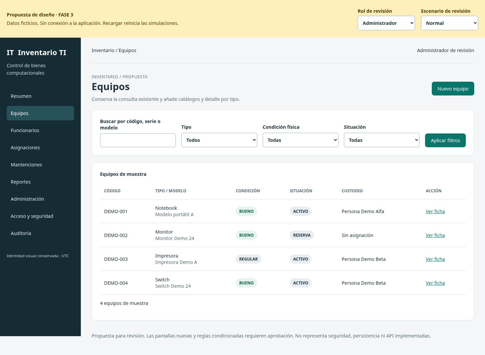
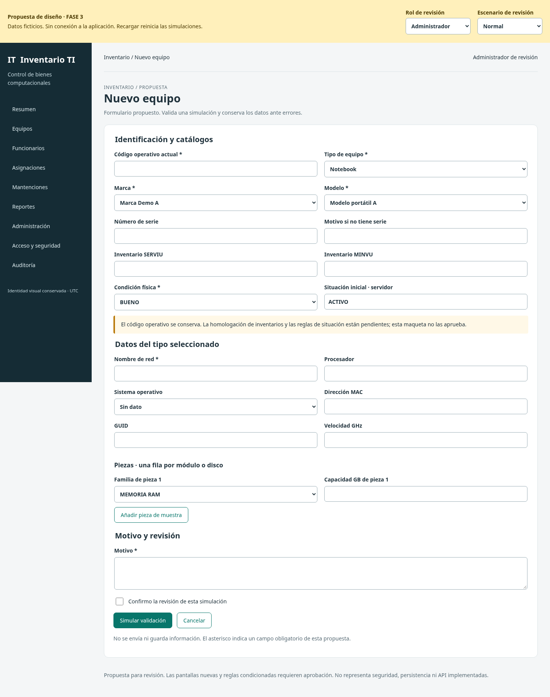
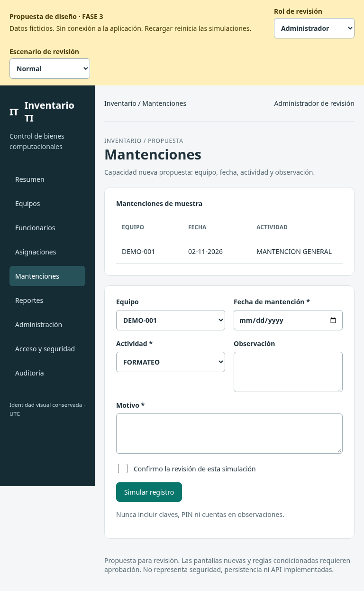
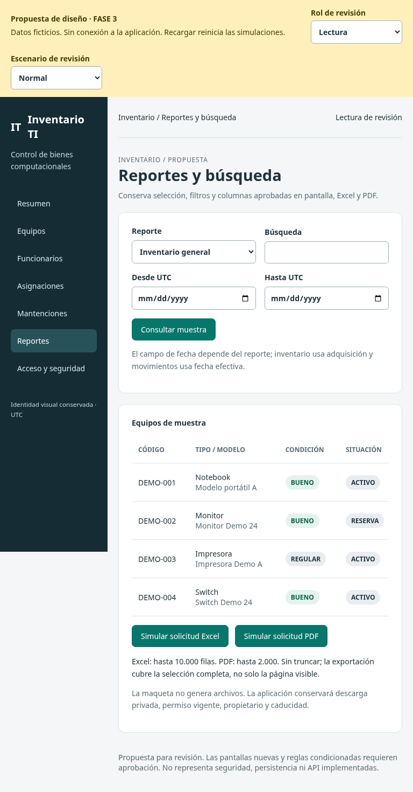
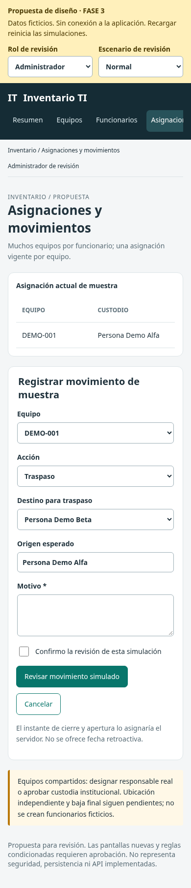
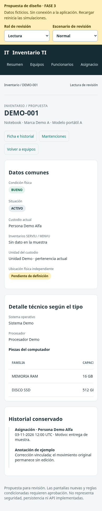

# FASE 3 — Diseño visual para revisión

Fecha: 2026-11-03. Estado: **EN_REVISION / SIN APROBACIÓN VISUAL PRESUMIDA**.

## Qué se está mostrando

Prototipo documental aislado de React, datos reales, API y base de datos. Conserva paleta, tipografía, lateral, tarjetas, formularios y tablas del frontend existente. Controles de rol/escenario en la franja amarilla son solo para revisión. Las pantallas y acciones se identifican como propuesta o simulación; no se guardan datos ni se genera correo/Excel/PDF.

El [mapa de 11 vistas](03_PANTALLAS.csv) incluye resumen, catálogo, ficha/historial, alta por tipo, funcionarios, asignaciones, mantenciones, administración, acceso/seguridad, auditoría y reportes. No se reconstruye la interfaz ni se modifica apps/web.

## Recorridos de revisión

1. Equipos → buscar DEMO-001 → ficha → historial → registrar movimiento. Confirmar que condición, situación y custodia se distinguen.
2. Nuevo equipo → alternar PC/notebook/monitor/impresora/switch/periférico. Ver módulos aplicables, modelos filtrados por marca, RAM/discos en filas. Cambiar a periférico no crea subtipo ficticio.
3. Simular falta de serie sin motivo, código repetido, traspaso al mismo custodio y baja con custodia. Los errores conservan los campos; no hay escritura.
4. Funcionarios → edición administrativa. Conservar documento/cargo/pertenencias y separar cuenta; lectura no recibe esos datos de edición.
5. Administración/seguridad/auditoría → revisar permisos, pendiente de cuenta, último administrador y aviso incierto. Lectura recibe restricción al navegar directamente a administración/auditoría.
6. Reportes → cinco salidas y buscador; límites y rango UTC. Cambiar a lectura oculta auditoría; exportación queda claramente simulada.
7. Cambiar escenarios de carga, vacío, error y sin permiso. Revisar teclado, foco, tablas desplazables y móvil.

## Ejecución local

Desde raíz: `python3 -m http.server 4175 --bind 127.0.0.1 --directory docs/migracion/prototipo-fase3`. En esa misma máquina abrir `http://127.0.0.1:4175/`. Es una dirección local comprobada; no se afirma acceso desde tu dispositivo ni hay enlace público desplegado. Descargar/clonar la rama permite repetirla en tu equipo. El navegador puede abrir también los archivos locales, pero el ensayo reproducible usa HTTP loopback.

Ensayo: `python3 docs/migracion/evidencias/fase3/verificar_prototipo.py` con Python Playwright y /usr/bin/chromium. El servidor de ensayo usa puerto local libre y se cierra al terminar. No hay dependencias de ejecución para la maqueta aparte del navegador/servidor de archivos.

## Capturas reales de la maqueta

Las capturas siguientes se produjeron con Chromium; representan la propuesta sintética, no la aplicación modernizada en funcionamiento.

### Catálogo · escritorio · administrador

### Alta por tipo · escritorio · administrador

### Mantenciones · tablet · administrador

### Reportes · tablet · lectura

### Traspaso · móvil · administrador

### Ficha · móvil · lectura

## Diseño, accesibilidad y límites

Se preservan tokens y componentes del CSS base. Labels visibles, un h1 por vista, regiones de tablas con scroll de teclado, captions/encabezados, estado anunciado con role=status/alert, foco al título, enlace de salto que conserva hash, controles móviles de tamaño adecuado y flujo en una columna. Los estados usan texto además de color. Se revisaron capturas reales para comprobar jerarquía/legibilidad y adaptación, no solo existencia de archivos.

Evidencia detallada en [navegador.json](evidencias/fase3/navegador.json). La prueba comprueba navegación de ambos perfiles/11 vistas/3 tamaños, estados, validaciones ilustrativas, controles, scroll y ausencia de llamadas API/externas. No es axe, auditoría manual integral ni certificación WCAG. Las tablas se desplazan dentro de su región; no hay desborde global según ensayo. No se probaron Safari/iPad/iPhone físicos ni lector de pantalla.

## Puntos concretos para aprobar

Revisar navegación agrupada, densidad de tablas, campos por tipo, modelo filtrado por marca, separación condición/situación/asignación, flujo de motivos/confirmación, visibilidad por rol, presentación móvil y estados de conflicto. Ubicación/compartidos, identidad, inventarios, baja final y reglas condicionadas siguen visibles como pendientes. Aprobar este diseño no implementa SQL/API ni activa envíos.

Fase 3 EN_REVISION. Se solicita aceptación visual y de contratos por separado de la ejecución del plan ETL de Fase 4.

Fase 4: **NO AUTORIZADA**.
