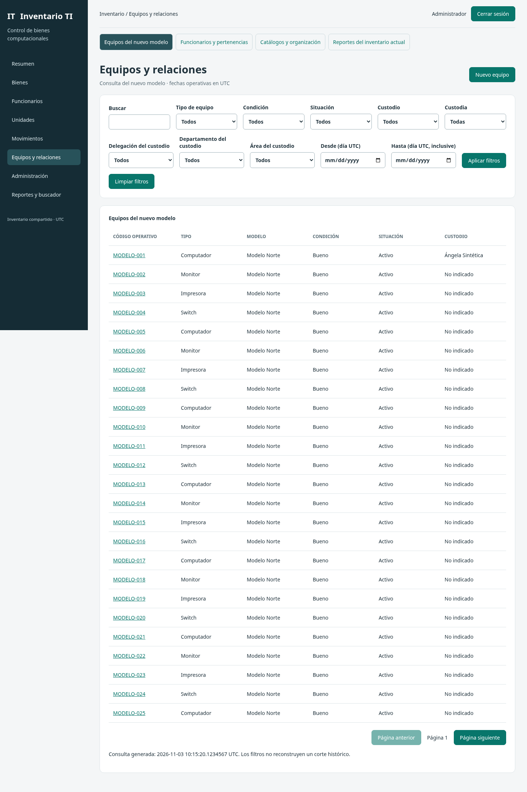
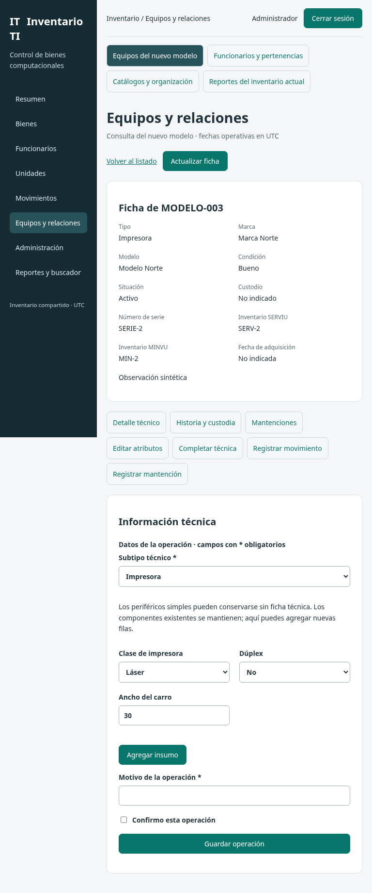
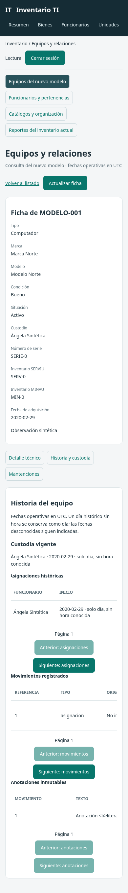

# FASE 7 — Adaptación visual e interacción

Fecha local: 2026-11-03, America/Santiago. Base aceptada: `1d7fac011780651f2b21516265b76ab58d631747`.
**Estado: EN_REVISION de la interfaz implementada. Integración del modelo de destino BLOQUEADA por los pendientes heredados. Fase 8 NO AUTORIZADA.**

## Aprobación, objetivo y plan

**M7-A01:** usuario «apruebo fase 6 inicia fase 7». Acepta la entrega parcial F6, que declaraba cero escrituras normalizadas implementadas, y autoriza esta fase visual. La aceptación no convierte esas escrituras o los ensayos SQL Server ausentes en implementados/aprobados. No se vuelve a pedir permiso para iniciar F7 ni para M6-A02/A03; continúan las decisiones de conservación de Auth, soporte, Unicode y UTC.

Objetivo: adaptar React y sus interacciones al nuevo modelo conservando interfaz, contratos y funcionalidades actuales. Plan ejecutado: revisar F3/F6 y frontend; reutilizar shell/tokens/campos; implementar cliente y rutas del nuevo modelo; verificar roles, formularios, fechas, reintentos y estados; ensayar responsive; registrar evidencia y sincronizar GitHub sin main/merge/despliegue. Responsable de implementación/verificación: Codex; revisión visual y aceptación: usuario.

Se aplicó [visual-system-designer](../../SKILL.md) dentro de F7 ya autorizada, junto con las instrucciones del entorno cloud para Docker/navegador local. Se leyeron AGENTS, ambos prompts, FASES/ESTADO/README/INICIAR, requisitos, UX, contratos/diseño F3, informe F6 y fuentes del frontend; las fuentes originales del modelo se cotejan por hash. No se instaló Spec Kit. ER/DER/Excel, maqueta F3 y evidencias históricas se conservan mediante hashes.

## Componentes e interacción implementados

- La aplicación mantiene React, autenticación/sesión/MFA existentes, menú, tarjetas, paleta y rutas v1. `Field` se extrae a `fields.tsx` para reutilizarlo sin importar el punto de montaje; conserva su límite predeterminado y permite límites específicos. ApiError pasa a un módulo común sin cambiar su identidad para los consumidores.
- Nueva área **Equipos y relaciones**, bajo `#modelo/…`, en la misma aplicación. `model.tsx`, `model-form.tsx`, `model-history.tsx`, `model-data.ts` y `model-guard.ts` separan vistas, formularios, proyecciones, preparación de comandos y operación pendiente. Los ajustes CSS están acotados a `.model-panel`; no se rediseñan las pantallas existentes.
- `modelApi` usa exclusivamente `/api/v2/`, cookies del mismo origen y CSRF en comandos. No redirige llamadas a v1 ni fabrica resultados. La demo v1 conserva su comportamiento y no simula el nuevo modelo. Los datos ficticios de esta fase están exclusivamente en fixtures/pruebas.
- Listados de equipos y funcionarios: búsqueda, fechas UTC, paginación/cursor, limpieza y reinicio de filtros, nombres de referencias y campos organizativos. En equipos la organización se etiqueta **del custodio**, sin inventar una ubicación física independiente. Marca filtra modelos y limpia el modelo seleccionado al cambiarla; no viaja como atributo duplicado del equipo.
- Catálogos: doce familias y cuatro grupos organizativos, tablas y paginación; modelos con marca. Los selectores cargan todas las páginas, detectan cursores repetidos y referencias duplicadas; no omiten silenciosamente resultados. Límite defensivo de 50 páginas de 100 por catálogo: al excederlo falla la carga, sin presentar una lista parcial como completa. Una evolución a búsqueda remota será necesaria para catálogos mayores.
- Ficha: condición, situación y custodia separadas; serie, inventarios, adquisición y datos técnicos. Computador/notebook incluye red, SO, procesador, GHz, MAC/GUID y componentes por filas; monitor, pulgadas; impresora, clase/dúplex/carro e insumos por filas; switch, puertos. Tipos con información técnica no se cambian desde el formulario de atributos. No se infiere la matriz empresarial tipo/subtipo ni se crean subtipos para periféricos simples.
- Alta común y técnica son pasos separados, como los contratos existentes: el alta confirmada no se presenta como una transacción agregada con una solicitud técnica posterior. Las filas técnicas nuevas no borran componentes omitidos.
- Custodia: comandos de asignación/devolución/traspaso/condición/baja/reactivación, motivo y confirmación; origen esperado tomado de la ficha y versión enviada por If-Match. No se pide una fecha operativa al cliente. Las reglas definitivas siguen siendo responsabilidad del backend y sus pendientes no se resuelven por dibujar opciones.
- Historia: asignaciones, movimientos, anotaciones inmutables y custodia vigente; tres cursores independientes. DATE histórico se presenta como día sin hora, NULL como desconocido y los instantes como UTC conservando sus decimales. No se convierten días a medianoche. Texto mostrado mediante React, sin HTML arbitrario.
- Mantenciones: actividad, fecha de actividad y observación; fecha de registro separada en UTC. Funcionarios: documento/cargo/correo en formulario administrativo, pertenencias referenciadas y ficha pública sin datos privados. Cambiar pertenencia no emite un traslado de equipos.
- Comandos: Idempotency-Key estable, carga serializada y ETag conservados durante un reintento incierto; bloqueo de navegación y aviso antes de recargar. Ante 412/428 se conservan campos y se exige una recarga explícita antes de guardar. Ante 400/403/422 o ausencia explícita de capacidad no se anuncia éxito. 401 desmonta la vista y vuelve al acceso. El aviso queda **pendiente**, nunca se anuncia correo enviado.

## M7-C01 — Extensión compatible de lectura para editar sin perder atributos

F3/F6 `EquipoDetalle` no incluía los siete atributos opcionales que `EquipoAtributos` reemplaza completamente. Editar esa ficha rellenando campos ausentes con vacío habría borrado información desconocida.

`apps/server/modernization/read-contract.ts` añade **opcionalmente** origenRef, numeroSerie, motivoSinSerie, inventarioServiu, inventarioMinvu, adquisicion y observacion a la respuesta de ficha, usando las mismas definiciones ya existentes. `routes.ts` aplica esa extensión antes de compilar schemas de lectura. No cambia campos requeridos, peticiones, códigos, permisos, ETags o rutas; una respuesta anterior sigue siendo válida. Se mantienen intactos el JSON F3 y el contrato generado F6 originales.

La UI habilita la edición de atributos solo cuando recibe **los siete campos presentes**, incluso cuando su valor explícito es NULL, y un ETag válido. Una ficha parcial mantiene consulta pero no permite ese PATCH. No se rellena la información ausente para aparentar compatibilidad. Esta extensión de contrato no implementa el repositorio de destino ni garantiza conservación física de textos largos.

## Navegación y conservación por vista

La [matriz de cobertura](07_COBERTURA_VISUAL.csv) vincula las once vistas F3 y los contratos. Se usan 17 de los 18 contratos v2 para navegación/formularios. C03-17 no recibe un formulario de UUID arbitrarios: faltan catálogo de perfiles y política efectiva ratificada. Administración de cuentas, permisos, auditoría y avisos continúa en sus módulos v1, con sus protecciones actuales.

Resumen, cinco reportes, buscador y exportaciones XLSX/PDF actuales se conservan. El enlace se denomina **Reportes del inventario actual**; no mezcla cifras v1 con los equipos del nuevo modelo. Adaptar reportes a la persistencia de destino permanece bloqueado por repositorios/contratos de selección pendientes; no hay exportación nueva simulada.

## Ensayo y evidencia

[Resultados, comandos y límites](evidencias/fase7/pruebas.json), [navegador](evidencias/fase7/navegador.json), [linaje](evidencias/fase7/linaje.json) y logs separados. La prueba nueva sirve el bundle React real, usa AuthService/sesión/MFA/RLS/HTTP reales de PostgreSQL local sintético y `ModelContractDouble` como **doble de persistencia v2**. Sus resultados en memoria no acreditan atomicidad de custodia, idempotencia SQL Server, integridad o permanencia de datos de destino.

Se ensayan lectura/administrador, denegación directa en servidor, ausencia de datos privados en lectura, catálogos paginados, alta/técnica por cuatro subtipos, conflicto 412, respuesta perdida y misma solicitud, mantenciones, pertenencias, ficha incompleta y módulo no disponible en el BFF predeterminado. Se capturan 1440/768/390 px para ambos roles, se comprueba ausencia de desborde global y foco/teclado; las tablas se desplazan dentro de su región. Axe comprueba automáticamente el panel móvil de lectura y el formulario administrativo; no certifica WCAG completo.

### Escritorio · administración · listado

### Tablet emulada · administración · impresora

### Móvil emulado · lectura · historia

Las otras tres capturas están enlazadas en navegador.json. La revisión visual detectó títulos/paginación móvil comprimidos y capturas con scroll/foco desplazado; se ajustaron las reglas locales y se regeneraron. Los primeros intentos también detectaron selectores accesibles incompletos, ruta vacía con edición, y esperas de prueba anteriores al resultado de un comando; se corrigieron y reensayaron. Se registró un intento interrumpido y una colisión de puerto entre ensayos: los resultados válidos corresponden a la ejecución final secuencial, no a esos intentos.

## Reproducción

Con Node 24 y dependencias fijadas: `npm ci`, `npm run build`, `npm test`, `npm run test:ops`, `npm run test:ui`, `npm audit --audit-level=high`. Para operaciones el checkout debe conservar su metadata Git; los fixtures requieren Docker local, espacio suficiente, Chromium y las herramientas de PDF existentes. Son contenedores locales sintéticos; no apuntar fixtures al proyecto Supabase remoto. La prueba nueva se ejecuta sola con `npx --no-install tsx --test tests/ui/model.test.ts`; sus puertos locales son 4317/4318 y se cierran al terminar. No ejecutarla concurrentemente consigo misma.

`npm start` mantiene su configuración PostgreSQL existente. Mientras main no registre un backend v2 utilizable, el nuevo módulo mostrará **todavía no habilitado**, con retorno al inventario actual; este comportamiento está probado. El recorrido positivo y las capturas se reproducen mediante el fixture anterior, sin instalar un doble en la aplicación. No existe una URL pública nueva ni despliegue accesible desde dispositivos del usuario.

Verificación estática vigente: `python3 docs/migracion/verificar_fase7.py`. Los verificadores F1–F6 corresponden a sus commits históricos; no se actualiza su evidencia para hacer coincidir cambios nuevos autorizados. SQL candidato conserva los cuatro archivos idénticos a F6 y sus THROW; solo se actualiza metadata de continuidad a revisión 0.6.0-review.2. Supabase remoto, bases de datos y permisos no se modifican.

## Criterios, riesgos y siguiente paso

| Criterio | Estado |
|---|---|
| CA-M7-01 conservar identidad visual y recorridos existentes | APROBADA en regresión local |
| CA-M7-02 vistas/formularios/relaciones y contratos del alcance visual | APROBADA con persistencia v2 doble; C03-17 y reportes de destino bloqueados explícitamente |
| CA-M7-03 carga/vacío/error/sin permiso/conflicto/reintento | APROBADA en ensayo de navegador |
| CA-M7-04 escritorio/tablet/móvil, ambos roles y evidencia | APROBADA en Chromium emulado; no hardware/Safari |
| CA-M7-05 integración de persistencia del destino y datos reales | BLOQUEADA por pendientes heredados; no sustituida por mocks |
| CA-M7-06 aceptación visual de esta entrega y cierre | PENDIENTE del usuario |

SQL Server 2016/130 sigue sin instancia/edición/SP/CU/collation ni pruebas de integración; faltan soporte físico, repositorios/escrituras, correspondencias de personas y reglas M1-D aplicables. No se considera lista una migración ni una puesta en operación por aceptar interfaz. La ausencia de Excel operacional impide perfilado/carga, no estos ensayos sintéticos. Retención, presupuesto y operación de respaldo F1-SEG-01/02/03 permanecen abiertos.

Revisar navegación, densidad de filtros/tablas, formularios por tipo y lectura móvil en las capturas; aceptar o corregir dentro de F7. Fase 8, seguridad/auditoría/regresión del modelo, requiere autorización independiente. No hay merge, main modificado, despliegue, producción, correo externo ni reactivación de inventarioTI.
